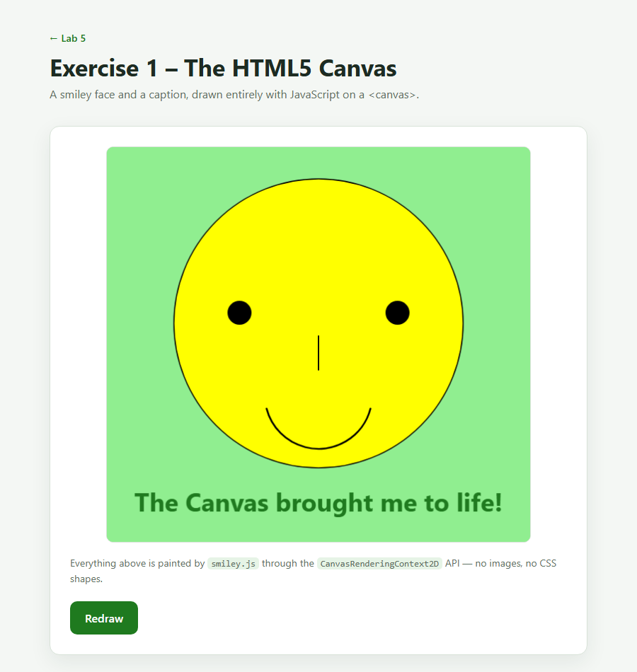
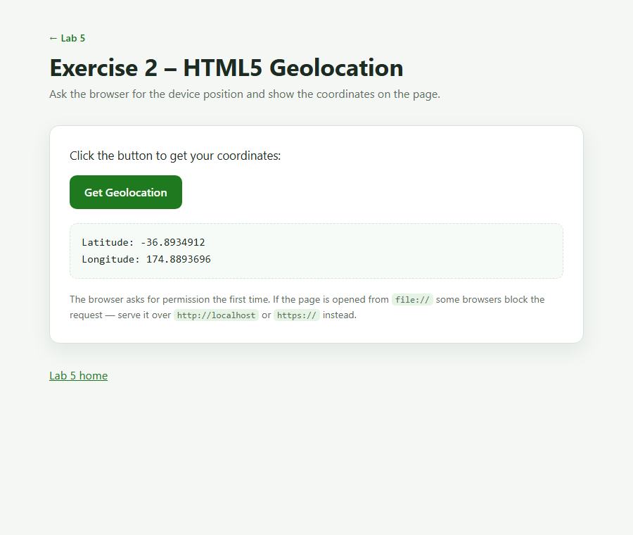
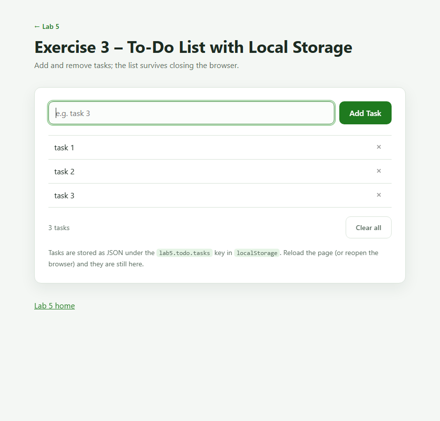

# Lab 5 &ndash; HTML5 Practical Exercises

Three self-contained browser exercises from the Lab Practical sheet, written with
plain HTML, CSS and JavaScript. No frameworks, no build step, no dependencies &mdash;
open a file and it runs.

**Live demo:** <https://tengdaiyuan.github.io/lab5/>

| # | Exercise | Topic | Source |
|---|----------|-------|--------|
| 1 | [The HTML5 Canvas](exercise1-canvas/) | `<canvas>` + 2D drawing API | [`smiley.js`](exercise1-canvas/smiley.js) |
| 2 | [HTML5 Geolocation](exercise2-geolocation/) | `navigator.geolocation` | [`geolocation.js`](exercise2-geolocation/geolocation.js) |
| 3 | [To-Do List with Local Storage](exercise3-localstorage/) | `window.localStorage` | [`todo.js`](exercise3-localstorage/todo.js) |

The [landing page](index.html) links to all three.

---

## Exercise 1 &ndash; The HTML5 Canvas

**Goal:** recreate the reference picture &mdash; a yellow smiley face on a light
green board with the caption *"The Canvas brought me to life!"* &mdash; using only
the Canvas 2D API.



How it is drawn ([`smiley.js`](exercise1-canvas/smiley.js)):

1. `fillRect()` paints the light green board (`#90ee90`) over the whole canvas.
2. `arc()` + `fill()` + `stroke()` draw the yellow face disc with its thin outline.
3. Two more `arc()` calls fill the black eyes.
4. `moveTo()` / `lineTo()` / `stroke()` draw the vertical nose.
5. A single `arc()` from `0.08π` to `0.92π` draws the smile, because canvas angles
   grow clockwise and that sweep covers the *lower* half of the circle.
6. `fillText()` writes the caption in dark green. The font size is chosen by
   measuring the string (`measureText()`) and shrinking it until it fits 88% of the
   canvas width, so the caption spans the board exactly like the reference.

The drawing is resolution independent: the backing store is scaled by
`devicePixelRatio` while all coordinates stay in logical `600 × 560` units, so the
canvas stays crisp on high-DPI screens and after the **Redraw** button is pressed.

## Exercise 2 &ndash; HTML5 Geolocation

**Goal:** a button that asks the browser for the device position and prints the
latitude and longitude into the page.



- The markup follows the lab sheet: a button with `onclick="getGeolocation()"` and a
  paragraph with `id="geolocation"`.
- `getGeolocation()` ([`geolocation.js`](exercise2-geolocation/geolocation.js)) first
  tests `if (navigator.geolocation)` and shows `"Geolocation is not supported by this
  browser."` when the API is missing.
- Otherwise it calls `navigator.geolocation.getCurrentPosition(showGeolocation, showError, options)`
  with `enableHighAccuracy`, a 10 s timeout and `maximumAge: 0`.
- `showGeolocation(position)` writes exactly the two lines required by the sheet:
  `Latitude: …` / `Longitude: …`.
- `showError(error)` replaces the message with a readable reason when permission is
  denied, the position is unavailable, or the request times out.

> **Running it:** browsers only expose the Geolocation API to secure contexts. Serve
> the folder instead of double-clicking the file, e.g.
> `python -m http.server 8000`, then open <http://localhost:8000/exercise2-geolocation/>.
> On `file://` some browsers refuse the request outright.

## Exercise 3 &ndash; To-Do List with Local Storage

**Goal:** add and remove tasks, and keep them after the browser is closed.



- Tasks live in an array of `{ id, text }` objects that is serialised with
  `JSON.stringify()` into `localStorage` under the key `lab5.todo.tasks` after every
  change ([`todo.js`](exercise3-localstorage/todo.js)).
- On load the array is parsed back and rebuilt into the list, so a reload or a fresh
  browser session restores the tasks.
- Adding: the form's `submit` handler calls `preventDefault()`, trims the input and
  ignores blank entries. Removing: the `×` button on each row deletes that id and
  saves again. **Clear all** empties the list after a confirmation prompt.
- Task text is inserted with `textContent`, so a task like `<b>hi</b>` is shown
  literally and never parsed as HTML.
- The footer keeps a live count, and a `storage` event listener re-renders the list
  when another tab changes it.

Stored value example:

```json
[
  { "id": "b1e4…", "text": "task 1" },
  { "id": "9f02…", "text": "task 2" }
]
```

---

## Project structure

```
lab5/
├── index.html                     # landing page linking the three exercises
├── assets/
│   └── style.css                  # shared styling
├── exercise1-canvas/
│   ├── index.html
│   └── smiley.js                  # Canvas 2D drawing code
├── exercise2-geolocation/
│   ├── index.html
│   └── geolocation.js             # getGeolocation / showGeolocation / showError
├── exercise3-localstorage/
│   ├── index.html
│   └── todo.js                    # add, remove, persist
└── screenshots/                   # images used by this README
```

## Running the pages

Any static server works:

```bash
# Python 3
python -m http.server 8000

# or Node
npx serve .
```

Then open <http://localhost:8000/> for the overview page.

Opening `index.html` directly from disk works for Exercises 1 and 3; Exercise 2
needs `http://localhost` or `https://` (see the note above).

## Verification

The exercises were exercised end to end in headless Edge over the DevTools
protocol, not just eyeballed:

- **Exercise 1** &ndash; canvas is `600 × 560`, background, face, eyes and smile
  sample the expected colours, and the caption is auto-fitted to the board.
- **Exercise 2** &ndash; with a mocked position, clicking the button rendered
  `Latitude: -36.8934912` / `Longitude: 174.8893696` &mdash; the same values as the
  example in the lab sheet.
- **Exercise 3** &ndash; adding three tasks wrote them to `localStorage`; a reload
  restored all three; deleting one updated the UI *and* the stored JSON; a blank
  input was rejected; HTML-like text stayed literal.

## Browser support

Chrome, Edge, Firefox and Safari (current versions). `localStorage` and Canvas are
universally supported; geolocation additionally requires either a secure origin or
a user-granted permission.

## Author

Teng Daiyuan &mdash; Lab 5 practical, 2026.
